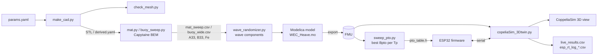
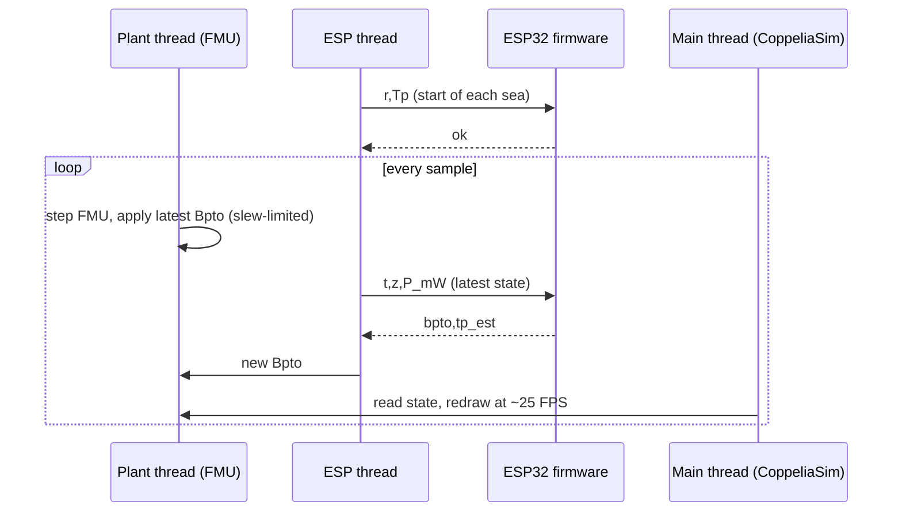

# Wave Energy Converter: Digital Twin and ESP32 Damping Controller

A model-scale heaving point-absorber wave energy converter (WEC), simulated end to end: hydrodynamics from a BEM solver, a time-domain heave model exported as an FMU, a sea-state-adaptive power take-off (PTO) damping controller written in C, firmware that runs that controller on an ESP32 (simulated in Wokwi), and a real-time 3D visualisation in CoppeliaSim.

> **Status:** research / prototype code. There is no package, test suite or dependency manifest, and several scripts contain hard-coded Windows paths (see [Limitations](#limitations-and-known-issues)). The repository contains **no measured results**, so none are reported here.

## Table of contents

- [Overview](#overview)
- [How it works](#how-it-works)
- [Repository structure](#repository-structure)
- [Technologies](#technologies)
- [Prerequisites](#prerequisites)
- [Setup](#setup)
- [Running the project](#running-the-project)
  - [1. Generate the CAD](#1-generate-the-cad)
  - [2. Hydrodynamics (Capytaine)](#2-hydrodynamics-capytaine)
  - [3. Build the FMU](#3-build-the-fmu)
  - [4. Build the PTO lookup table](#4-build-the-pto-lookup-table)
  - [5. Build and run the ESP32 firmware](#5-build-and-run-the-esp32-firmware)
  - [6. Real-time digital twin](#6-real-time-digital-twin)
  - [Offline closed-loop checks](#offline-closed-loop-checks)
- [Model and controller details](#model-and-controller-details)
- [Serial protocol](#serial-protocol)
- [Outputs](#outputs)
- [Limitations and known issues](#limitations-and-known-issues)
- [Missing from the repository](#missing-from-the-repository)
- [Contributing](#contributing)
- [License](#license)

## Overview

**Problem.** A heaving buoy extracts the most power when its PTO damping matches the sea. The best damping depends on the peak wave period `Tp`, which changes with sea state. A fixed damping setting is therefore only good for one sea.

**What the project implements:**

- **Geometry.** A parametric CAD model of a buoy, shaft, seabed base and an optional submerged ring "mat" (CadQuery), exported as STEP and STL, with mesh sanity checks.
- **Hydrodynamics.** Linear potential-flow (BEM) heave sweeps with Capytaine: added mass, radiation damping, excitation force, optimal PTO damping and maximum absorbable power, with and without the mat.
- **Time-domain plant.** A Modelica heave model (`WEC_Heave.mo`) driven by 20 irregular-wave components, with a PTO damper whose damping `Bpto` is an input. It reports instantaneous power and accumulated energy.
- **Controller.** The controller estimates `Tp` from upward zero-crossings of the heave signal and looks up the best `Bpto` from a table. It exists in two versions: a general C implementation (`wec-controller/`) and the ESP32 firmware (`wec-esp32/`), which is the version the live demo uses.
- **Digital twin.** A Python host script runs the FMU in real time, talks to the ESP32 over serial, and animates the buoy and waves in CoppeliaSim. Results from this live run are timing-dependent and are not intended as evaluation numbers (the script says so itself).

## How it works



At run time the live demo works as three cooperating threads:



The ESP32 never queues samples. If it answers slowly, intermediate samples are skipped, and the firmware computes timing from the timestamps it receives.

## Repository structure

```
.
├── WEC_Heave.mo               Modelica heave model (20 wave components, Bpto input)
├── copeliaSim_3Dtwin.py       Real-time host: FMU + ESP32 serial + CoppeliaSim visualisation
├── tz_check.py                Measures Tp/Tz ratio of the firmware-style period detector
├── wec-twin/                  CAD, BEM hydrodynamics and PTO-table generation
│   ├── params.yaml            Single source of truth for geometry and environment
│   ├── make_cad.py            CadQuery: STEP/STL export + derived.yaml
│   ├── check_mesh.py          Watertightness, winding, volume checks on the STLs
│   ├── bouy.py                Capytaine heave sweep, buoy alone (file name is spelled "bouy")
│   ├── mat.py                 Capytaine sweep: buoy vs buoy + submerged mat
│   ├── buoy_sweep.py          Wide-band buoy-only sweep -> results/buoy_wide.csv
│   ├── wave_randomizer.py     Prints Modelica arrays (wi, ai, Fi, ph) for a JONSWAP sea
│   ├── sweep_pto.py           Finds best Bpto per Tp from the FMU -> pto_table.csv/.h
│   └── sim.py                 Minimal fmpy run: mean power for three fixed Bpto values
├── wec-controller/            PC-side C controller
│   ├── controller.c/.h        Tp estimator + lookup + survival mode + slew limit
│   ├── test_ctrl.c            Console test with a synthetic sine and changing Tp
│   ├── closed_loop.py         Loads controller.dll via ctypes, runs against the FMU
│   └── *.pdb, controller.lib  Windows build artefacts committed to the repo
└── wec-esp32/                 ESP32 firmware (PlatformIO, Arduino framework) + Wokwi
    ├── platformio.ini         Board esp32dev, Adafruit SSD1306/GFX
    ├── wokwi.toml             Wokwi config, RFC2217 serial server on port 4000
    ├── diagram.json           Wokwi circuit: ESP32, MPU6050, SSD1306, potentiometer, LED
    ├── src/main.cpp           Firmware: serial protocol, period estimator, OLED, LED PWM
    ├── src/hal.h              Pin map and the USE_SIM_SERIAL flag
    ├── src/pto_table_wide.h   Tp -> Bpto table (16 points, Tp 0.5-2.0 s) and interpolation
    ├── src/controller.c/.h    Copy of the PC controller (not used by main.cpp)
    └── closed_loop_esp32.py   Older lockstep ESP32 test (see known issues)
```

## Technologies

| Area | Tools (as imported or configured in the repo) |
|---|---|
| CAD | CadQuery, trimesh, PyYAML |
| Hydrodynamics | Capytaine (BEM), xarray, NumPy, Matplotlib |
| Plant model | Modelica (OpenModelica is implied by the `.gitignore` and `.fmu` workflow), FMI 2.0 via fmpy |
| Optimisation / data | SciPy (`minimize_scalar`), pandas |
| Controller | C (PC build via `ctypes`), C++/Arduino for the ESP32 |
| Embedded | PlatformIO, `espressif32`, Adafruit SSD1306 and GFX, Wokwi simulator |
| Visualisation | CoppeliaSim with the ZMQ remote API (`coppeliasim_zmqremoteapi_client`) |
| Serial | pyserial (the host connects through `rfc2217://`) |

## Prerequisites

- Python 3 with the packages above. There is no `requirements.txt`; the list is inferred from imports.
- **Windows is assumed** by the code as committed: paths are `G:\Projects\Wave_Energy_Converter\...`, and `controller.dll` / `__declspec(dllexport)` are Windows-oriented.
- OpenModelica (or another tool) to build the FMU from the `.mo` file.
- PlatformIO (CLI or VS Code extension) and Wokwi (VS Code extension or CLI) for the firmware.
- CoppeliaSim with the ZMQ remote API enabled, for the live demo.
- A C compiler (for example MSVC or MinGW) if you want `wec-controller`.

## Setup

```bash
git clone https://github.com/An-OddGuy/Wave-Energy-Converter.git
cd Wave-Energy-Converter

python -m venv .venv
# Windows:  .venv\Scripts\activate
# Linux/macOS:  source .venv/bin/activate

pip install numpy pandas scipy pyyaml pyserial fmpy matplotlib xarray trimesh capytaine cadquery coppeliasim-zmqremoteapi-client
```

Exact versions are not pinned in the repository. Capytaine 3.x is referenced in the docstring of `wec-twin/bouy.py`.

**Paths to edit.** These are hard-coded and must be changed for your machine:

| File | Variable |
|---|---|
| `copeliaSim_3Dtwin.py` | `FMU`, `CAD` (or pass `--fmu`) |
| `wec-controller/closed_loop.py` | `FMU` |
| `wec-esp32/closed_loop_esp32.py` | `FMU`, `CSV` |
| `wec-twin/sim.py` | FMU path inside `simulate_fmu(...)` |

## Running the project

Run the `wec-twin` scripts from inside `wec-twin/`. They write to `results/` and `cad_out/`, both of which are git-ignored.

### 1. Generate the CAD

```bash
cd wec-twin
python make_cad.py              # reads params.yaml, writes cad_out/
python make_cad.py --mat-depth 0.25
python check_mesh.py            # exit code 0 if all meshes pass
```

`make_cad.py` writes `<part>.step`, `<part>.stl`, `<part>_local.stl`, `assembly.step` and `derived.yaml` (mass, inertia, nominal poses). The geometry is a model-scale buoy (radius 0.12 m, height 0.20 m, draft 0.10 m) in 1.0 m of fresh water; see `params.yaml`.

### 2. Hydrodynamics (Capytaine)

```bash
python bouy.py                                      # buoy alone -> results/buoy_only.csv/.png
python mat.py --depths 0.05 0.15 0.30 --n 15        # buoy vs mat -> results/mat_sweep.csv/.png
python buoy_sweep.py --omega-min 2.2 --omega-max 13.5 --n 40   # -> results/buoy_wide.csv
```

`mat.py` and `buoy_sweep.py` need `cad_out/derived.yaml`, so run step 1 first. The `buoy_sweep.py` docstring warns that irregular frequencies appear above about 13.9 rad/s, so keep `--omega-max` at or below 13.5.

### 3. Build the FMU

Export `WEC_Heave.mo` as an FMU (the `.fmu` extension is git-ignored, so this is a local step). `wave_randomizer.py` prints the `wi`, `ai`, `Fi`, `ph` arrays that were pasted into the model; it reads `results/mat_sweep.csv`.

> The live demo and `sweep_pto.py` expect a **different model**, `WEC_Heave_Wide.fmu`, with `Tp`, `Hs` and `Bpto` inputs and a wider frequency grid. Its source is not in the repository (see [Missing from the repository](#missing-from-the-repository)).

### 4. Build the PTO lookup table

```bash
python sweep_pto.py     # needs WEC_Heave_Wide.fmu in the working directory
```

For each `Tp` from 0.5 to 2.0 s (Hs = 0.04 m), the script scans `Bpto`, refines the optimum with `scipy.optimize.minimize_scalar`, rejects rows at the grid edge or above a theoretical power bound, and writes `results/pto_table.csv` and `results/pto_table.h`. The committed `wec-esp32/src/pto_table_wide.h` is described in its header as generated from `wec-twin/results/pto_table_wide.csv`.

`tz_check.py` (it uses relative paths for `results/pto_table.csv` and `WEC_Heave_Wide.fmu`, so run it from the folder that holds both, presumably `wec-twin/`) simulates each valid table row and measures the mean zero-crossing period `Tz`, to calibrate the firmware constant `TZ_TO_TP = 1.03`.

### 5. Build and run the ESP32 firmware

```bash
cd wec-esp32
pio run                 # produces .pio/build/esp32/firmware.bin and .elf
```

Then start the Wokwi simulation (VS Code Wokwi extension or CLI). `wokwi.toml` points Wokwi at those build outputs and exposes the board's serial port as `rfc2217://localhost:4000`.

### 6. Real-time digital twin

1. Start CoppeliaSim with the ZMQ remote API available.
2. Start the Wokwi simulation of the ESP32.
3. Run the host:

```bash
python copeliaSim_3Dtwin.py                       # ESP32-controlled run
python copeliaSim_3Dtwin.py --fixed 12            # baseline: constant Bpto, no ESP32 needed
python copeliaSim_3Dtwin.py --speed 0.25          # slower plant clock (more samples per wave)
python copeliaSim_3Dtwin.py --solver cs --port rfc2217://localhost:4000
```

| Option | Default | Meaning |
|---|---|---|
| `--fmu` | `FMU` constant | Path to `WEC_Heave_Wide.fmu` |
| `--speed` | `0.5` | Plant seconds per wall-clock second |
| `--port` | `rfc2217://localhost:4000` | Serial URL of the board |
| `--pto` | auto-search | Path to `pto_table_wide.csv` (searched next to the script, in `results/`, in `wec-twin/results/`) |
| `--solver` | `auto` | `cvode` (Model Exchange), `cs` (co-simulation `doStep`), or `auto` (try CVode, fall back to `cs`) |
| `--fixed` | none | Hold `Bpto` constant (baseline) |

The script plays six seas in order, all with Hs = 0.04 m: Tp = 0.6, 0.81, 0.95, 1.2, 1.6, 2.0 s (12 to 40 s each). It builds a glass tank, water surface, and the buoy, shaft and base from the STL files in `CAD`, plus a damping meter that changes colour with `Bpto`. Each run appends the mean electrical power per sea to `live_results.csv`, so you can compare a controller run against `--fixed` runs.

### Offline closed-loop checks

- `wec-controller/test_ctrl.c` is a standalone console test (for example `gcc test_ctrl.c controller.c -lm`) that feeds a synthetic sine with Tp switching between 0.8, 1.1 and 0.7 s and prints the estimated `Tp`, RMS amplitude and `Bpto`.
- `wec-controller/closed_loop.py` compares the C controller against fixed damping of 7 and 12 N s/m on the FMU. It requires a locally built `controller.dll` and `wec-twin/results/mat_sweep.csv` (see known issues).

## Model and controller details

**Plant (`WEC_Heave.mo`).** Single degree of freedom heave:

`(m + A)·z'' = Fe − B·z' − Bpto·z' − K·z`, with `P = Bpto·z'²` and `E' = P`.

| Parameter | Value | Unit |
|---|---|---|
| Buoy mass `m` | 4.524 | kg |
| Added mass `A` | 2.85 | kg |
| Radiation damping `B` | 4.38 (at 8 rad/s) | N s/m |
| Hydrostatic stiffness `K` | 443.8 | N/m |

The excitation `Fe` is a sum of 20 components (5.1 to 8.9 rad/s). The natural period implied by these numbers is about 0.81 s, matching the comment in `copeliaSim_3Dtwin.py`.

**Firmware controller (`wec-esp32/src/main.cpp`).** There is no prediction.

1. Remove the slow mean from heave with a 10 s exponential filter.
2. Detect upward zero-crossings (with 0.3 mm hysteresis, interpolated between timestamps).
3. Each completed wave gives a period `T`. Accept it if 0.30 s ≤ T ≤ 3.00 s, convert with `TZ_TO_TP = 1.03`, and smooth with `TP_ALPHA = 0.4`.
4. Look up `Bpto` by linear interpolation in `PTO_BPTO` (clamped outside Tp 0.5-2.0 s) and hold it until the next wave completes.

The LED on GPIO25 follows `Bpto` through 8-bit PWM (range 3 to 100), and the OLED shows `Tp`, `Bpto` and power.

**Table values (`pto_table_wide.h`, Hs = 0.04 m):**

| Tp (s) | 0.5 | 0.6 | 0.7 | 0.8 | 0.9 | 1.0 | 1.2 | 1.5 | 2.0 |
|---|---|---|---|---|---|---|---|---|---|
| Bpto (N s/m) | 31.1 | 16.7 | 11.0 | 8.3 | 11.9 | 19.8 | 35.8 | 59.5 | 96.1 |

**PC controller (`wec-controller/controller.c`).** An alternative implementation with an 11-point table (Tp 0.70-1.20 s), a force-reconstruction-based crossing detector, a 3-40 N s/m range, a 5 N s/m per s slew limit, and a "survival" mode that jumps to maximum damping when RMS heave exceeds 0.06 m (marked as a placeholder in the code).

## Serial protocol

All lines end in `\n`, at 115200 baud.

| Host → board | Board → host | Purpose |
|---|---|---|
| `r,<tp>` | `ok` | Reset estimator, start at `pto_lookup(tp)` |
| `r` | `ok` | Reset, start at `B_INIT` = 7.0 |
| `<t>,<z>[,<p_mW>]` | `<bpto>,<tp_est>` | Plant time (s), heave (m), optional power for the OLED |

## Outputs

| File | Written by | Content |
|---|---|---|
| `wec-twin/cad_out/*` | `make_cad.py` | STEP/STL and `derived.yaml` |
| `wec-twin/results/*.csv`, `*.png` | BEM and sweep scripts | Hydrodynamic coefficients, plots, PTO tables |
| `live_results.csv` | `copeliaSim_3Dtwin.py` | Per sea: mode, speed, Tp, Hs, duration, mean power in mW |
| `esp_rt_log_Tp<Tp>.csv` | `copeliaSim_3Dtwin.py` | Per-sample t, z, bpto, tp_est, latency, RMS voltage/current, power |
| `esp_log_Tp<Tp>.csv` | `closed_loop_esp32.py` | t, z, bpto, tp_est |

`.csv`, `.fmu`, `.dll`, `results/` and `cad_out/` are all git-ignored, so none of these exist after a fresh clone.

## Limitations and known issues

Found by reading the code; none were verified by running it.

- **Hard-coded Windows paths** (`G:\Projects\Wave_Energy_Converter\...`) in four scripts.
- **No dependency manifest, license, tests or CI.**
- **Required inputs are not committed:** the FMU sources/binaries, `results/*.csv`, `cad_out/` and `controller.dll` are all missing or git-ignored.
- **`closed_loop_esp32.py` is out of date.** It sends only `z` per line, but the firmware ignores lines with fewer than two fields (`t,z`), so the script would wait for a reply that never comes. It also uses `wec-twin/results/mat_sweep.csv` for the wave grid, which does not match the wide model used elsewhere.
- **`wec-controller/closed_loop.py` has a duplicated `tp_est`, `amp_rms`, `bpto` block** in its `ctypes` `Ctrl` structure. This makes the structure larger than the C `ctrl_t`, so the layout does not match `controller.h`.
- **`main.cpp` header comment mentions `wec_realtime.py`**, which does not exist; the host script is `copeliaSim_3Dtwin.py`.
- **Sensors are simulated.** `hal.h` sets `USE_SIM_SERIAL 1`. The Wokwi diagram contains an MPU6050 and a potentiometer on pin 34, but the firmware does not read the IMU or ADC; heave arrives over serial.
- **`wec-esp32/src/controller.c` is not used** by `main.cpp`; the firmware has its own estimator.
- **The survival mode** and `RMS_SURVIVE` threshold exist only in the PC controller and are labelled placeholders.
- **The generator model in the live demo is rough:** `KF = 20` and `ETA = 1.0` are stated as adjustable assumptions, and power is the FMU's own `Bpto·v²`.
- **Live-run timing jitters.** The script's own docstring advises using the lockstep loop for evaluation numbers.
- **BEM is linear, regular-wave potential flow**, and `mat.py` notes that thin plates are handled poorly.
- **Windows build artefacts** (`controller.pdb`, `test_ctrl.pdb`, `controller.lib`) are tracked in `wec-controller/`.

## Missing from the repository

- The Modelica source (or FMU) for `WEC_Heave_Wide` with `Tp`, `Hs`, `Bpto` inputs and a 2-16 rad/s grid.
- `pto_table_wide.csv` (the committed header is its only trace).
- A dependency file and a licence.

## Contributing

There are no contribution guidelines in the repository. Issues and pull requests are reasonable places to start; if you contribute, remove the hard-coded paths you touch and keep generated files out of version control.

## License

No licence file was found in the repository, so no licence is granted by default. Contact the repository owner before reusing the code.
